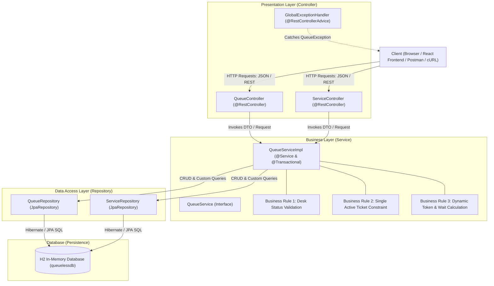

# Activity Report: Design and Develop a Basic Spring Boot Application

**Course / Module:** Full-Stack Web Development / Spring Boot Framework – Part 1  
**Project Topic:** QueueLess — Smart Virtual Queue Management System  
**Academic Year:** 2026  

---

## 1. Application Name & Problem Description

### Application Name
**QueueLess (Spring Boot Edition)** — Smart Virtual Queue Management System

### Problem Description
In universities and college administrative offices (e.g., Certificate Verification Counter, Accounts Section, IT Help Desk, and Library), students typically waste hours physically waiting in long lines. This results in hallway congestion, loss of academic time, and inefficient staff workflow.

**QueueLess** solves this problem by digitizing queue management:
- Students can join virtual queues from their devices.
- The system automatically allocates sequential digital tokens (e.g., `CERT-001`, `ACC-002`).
- Real-time calculations determine the student's exact queue position and estimated waiting time.
- Campus staff manage counters by calling tokens sequentially, marking completion, or handling no-shows.

---

## 2. Architecture Diagram (Three-Tier Architecture)

The application strictly implements the **Three-Tier / Three-Layer Architecture**:



---

## 3. Domain Model / Classes

The system defines **two core domain entities** with JPA annotations:

### Entity 1: `ServiceDesk`
Represents a campus administrative service counter.
* `id` (Long, Primary Key, Auto-generated)
* `name` (String, e.g., "Certificate Office")
* `prefix` (String, e.g., "CERT")
* `description` (String)
* `counterNumber` (String, e.g., "Counter 2")
* `location` (String, e.g., "Admin Block, Ground Floor")
* `averageServiceTimeMinutes` (Integer, e.g., 4)
* `status` (Enum: `OPEN`, `CLOSED`, `PAUSED`)
* `createdAt` (LocalDateTime)

### Entity 2: `QueueTicket`
Represents an active or historical queue token issued to a student.
* `id` (Long, Primary Key, Auto-generated)
* `tokenNumber` (String, e.g., "CERT-001")
* `studentId` (String, e.g., "2024-CSE-01")
* `studentName` (String, e.g., "Karthick R")
* `serviceDesk` (`@ManyToOne` relationship with `ServiceDesk`)
* `status` (Enum: `WAITING`, `CALLED`, `SERVING`, `COMPLETED`, `SKIPPED`, `CANCELLED`)
* `position` (Integer, position in line)
* `estimatedWaitMinutes` (Integer, computed waiting duration)
* `joinedAt` (LocalDateTime)
* `calledAt` (LocalDateTime)
* `completedAt` (LocalDateTime)

---

## 4. Project & Package Structure

```text
queueless-springboot/
├── pom.xml                                      # Maven project configuration
├── src/
│   ├── main/
│   │   ├── java/
│   │   │   └── com/
│   │   │       └── queueless/
│   │   │           ├── QueueLessApplication.java       # @SpringBootApplication & Seed Runner
│   │   │           ├── controller/                    # Presentation Layer
│   │   │           │   ├── QueueController.java
│   │   │           │   └── ServiceController.java
│   │   │           ├── service/                       # Business Layer
│   │   │           │   ├── QueueService.java
│   │   │           │   └── QueueServiceImpl.java
│   │   │           ├── repository/                    # Data Access Layer
│   │   │           │   ├── QueueRepository.java
│   │   │           │   └── ServiceRepository.java
│   │   │           ├── model/                         # Domain Entities
│   │   │           │   ├── ServiceDesk.java
│   │   │           │   ├── QueueTicket.java
│   │   │           │   ├── ServiceStatus.java
│   │   │           │   └── QueueStatus.java
│   │   │           ├── dto/                           # Data Transfer Objects
│   │   │           │   ├── JoinQueueRequest.java
│   │   │           │   └── ApiResponse.java
│   │   │           └── exception/                     # Exception Handling
│   │   │               ├── QueueException.java
│   │   │               └── GlobalExceptionHandler.java
│   │   └── resources/
│   │       └── application.properties                 # H2 and JPA Auto-Configuration
│   └── test/
│       └── java/
│           └── com/
│               └── queueless/
│                   ├── QueueLessApplicationTests.java # Context loading test
│                   └── service/
│                       └── QueueServiceTest.java      # Automated JUnit 5 & Mockito test
```

---

## 5. Controller Code (Presentation Layer)

```java
package com.queueless.controller;

import com.queueless.dto.ApiResponse;
import com.queueless.dto.JoinQueueRequest;
import com.queueless.model.QueueTicket;
import com.queueless.service.QueueService;
import org.springframework.beans.factory.annotation.Autowired;
import org.springframework.http.HttpStatus;
import org.springframework.http.ResponseEntity;
import org.springframework.web.bind.annotation.*;

import java.util.List;

@RestController
@RequestMapping("/api/queues")
@CrossOrigin(origins = "*")
public class QueueController {

    private final QueueService queueService;

    @Autowired
    public QueueController(QueueService queueService) {
        this.queueService = queueService;
    }

    @PostMapping("/join")
    public ResponseEntity<ApiResponse<QueueTicket>> joinQueue(@RequestBody JoinQueueRequest request) {
        QueueTicket ticket = queueService.joinQueue(request);
        return ResponseEntity
                .status(HttpStatus.CREATED)
                .body(ApiResponse.success("Successfully joined the virtual queue!", ticket));
    }

    @GetMapping("/active/{studentId}")
    public ResponseEntity<ApiResponse<QueueTicket>> getActiveTicket(@PathVariable String studentId) {
        QueueTicket ticket = queueService.getActiveTicket(studentId);
        return ResponseEntity.ok(ApiResponse.success("Active ticket retrieved", ticket));
    }

    @GetMapping("/waiting/{serviceDeskId}")
    public ResponseEntity<ApiResponse<List<QueueTicket>>> getWaitingTickets(@PathVariable Long serviceDeskId) {
        List<QueueTicket> waiting = queueService.getWaitingTickets(serviceDeskId);
        return ResponseEntity.ok(ApiResponse.success("Waiting list retrieved", waiting));
    }

    @PostMapping("/call-next/{serviceDeskId}")
    public ResponseEntity<ApiResponse<QueueTicket>> callNextTicket(@PathVariable Long serviceDeskId) {
        QueueTicket ticket = queueService.callNextTicket(serviceDeskId);
        return ResponseEntity.ok(ApiResponse.success("Next student called to counter", ticket));
    }

    @PostMapping("/{ticketId}/complete")
    public ResponseEntity<ApiResponse<QueueTicket>> completeTicket(@PathVariable Long ticketId) {
        QueueTicket ticket = queueService.completeTicket(ticketId);
        return ResponseEntity.ok(ApiResponse.success("Service marked as completed", ticket));
    }

    @DeleteMapping("/{ticketId}/cancel")
    public ResponseEntity<ApiResponse<QueueTicket>> cancelTicket(@PathVariable Long ticketId) {
        QueueTicket ticket = queueService.cancelTicket(ticketId);
        return ResponseEntity.ok(ApiResponse.success("Queue ticket cancelled", ticket));
    }
}
```

---

## 6. Service Code (Business Layer)

```java
package com.queueless.service;

import com.queueless.dto.JoinQueueRequest;
import com.queueless.exception.QueueException;
import com.queueless.model.*;
import com.queueless.repository.QueueRepository;
import com.queueless.repository.ServiceRepository;
import org.springframework.beans.factory.annotation.Autowired;
import org.springframework.stereotype.Service;
import org.springframework.transaction.annotation.Transactional;

import java.time.LocalDate;
import java.time.LocalDateTime;
import java.util.Arrays;
import java.util.List;
import java.util.Optional;

@Service
@Transactional
public class QueueServiceImpl implements QueueService {

    private final QueueRepository queueRepository;
    private final ServiceRepository serviceRepository;

    @Autowired
    public QueueServiceImpl(QueueRepository queueRepository, ServiceRepository serviceRepository) {
        this.queueRepository = queueRepository;
        this.serviceRepository = serviceRepository;
    }

    @Override
    public QueueTicket joinQueue(JoinQueueRequest request) {
        if (request.getServiceId() == null || request.getStudentId() == null || request.getStudentName() == null) {
            throw new QueueException("Service ID, Student ID, and Student Name must be provided");
        }

        // 1. Verify Service Desk Exists
        ServiceDesk desk = serviceRepository.findById(request.getServiceId())
                .orElseThrow(() -> new QueueException("Service desk not found with ID: " + request.getServiceId()));

        // --- BUSINESS RULE 1: Desk Operational Check ---
        if (desk.getStatus() != ServiceStatus.OPEN) {
            throw new QueueException("Cannot join queue: Service desk '" + desk.getName() + "' is currently " + desk.getStatus());
        }

        // --- BUSINESS RULE 2: Single Active Queue Policy ---
        List<QueueStatus> activeStatuses = Arrays.asList(QueueStatus.WAITING, QueueStatus.CALLED);
        Optional<QueueTicket> existingTicket = queueRepository.findByStudentIdAndStatusIn(request.getStudentId(), activeStatuses);
        if (existingTicket.isPresent()) {
            throw new QueueException("Student " + request.getStudentId() + " already holds an active ticket: " 
                    + existingTicket.get().getTokenNumber() + " at " + existingTicket.get().getServiceDesk().getName());
        }

        // --- BUSINESS RULE 3: Dynamic Token & Wait Time Calculation ---
        LocalDateTime startOfDay = LocalDate.now().atStartOfDay();
        long ticketsIssuedToday = queueRepository.countByServiceDeskIdAndJoinedAtAfter(desk.getId(), startOfDay);
        String tokenNumber = String.format("%s-%03d", desk.getPrefix(), ticketsIssuedToday + 1);

        long peopleAhead = queueRepository.countByServiceDeskIdAndStatusIn(desk.getId(), activeStatuses);
        int position = (int) (peopleAhead + 1);
        int estimatedWait = position * desk.getAverageServiceTimeMinutes();

        QueueTicket ticket = new QueueTicket(
                tokenNumber,
                request.getStudentId(),
                request.getStudentName(),
                desk,
                position,
                estimatedWait
        );

        return queueRepository.save(ticket);
    }

    @Override
    public QueueTicket getActiveTicket(String studentId) {
        List<QueueStatus> activeStatuses = Arrays.asList(QueueStatus.WAITING, QueueStatus.CALLED);
        return queueRepository.findByStudentIdAndStatusIn(studentId, activeStatuses)
                .orElseThrow(() -> new QueueException("No active queue ticket found for student ID: " + studentId));
    }

    @Override
    public List<QueueTicket> getWaitingTickets(Long serviceDeskId) {
        List<QueueStatus> waitingStatus = List.of(QueueStatus.WAITING);
        return queueRepository.findByServiceDeskIdAndStatusInOrderByJoinedAtAsc(serviceDeskId, waitingStatus);
    }

    @Override
    public QueueTicket callNextTicket(Long serviceDeskId) {
        List<QueueTicket> waiting = getWaitingTickets(serviceDeskId);
        if (waiting.isEmpty()) {
            throw new QueueException("No students are waiting in line for this desk");
        }

        QueueTicket nextTicket = waiting.get(0);
        nextTicket.setStatus(QueueStatus.CALLED);
        nextTicket.setCalledAt(LocalDateTime.now());
        return queueRepository.save(nextTicket);
    }

    @Override
    public QueueTicket completeTicket(Long ticketId) {
        QueueTicket ticket = queueRepository.findById(ticketId)
                .orElseThrow(() -> new QueueException("Ticket not found with ID: " + ticketId));

        ticket.setStatus(QueueStatus.COMPLETED);
        ticket.setCompletedAt(LocalDateTime.now());
        return queueRepository.save(ticket);
    }

    @Override
    public QueueTicket cancelTicket(Long ticketId) {
        QueueTicket ticket = queueRepository.findById(ticketId)
                .orElseThrow(() -> new QueueException("Ticket not found with ID: " + ticketId));

        if (ticket.getStatus() == QueueStatus.COMPLETED || ticket.getStatus() == QueueStatus.CANCELLED) {
            throw new QueueException("Cannot cancel a ticket that is already " + ticket.getStatus());
        }

        ticket.setStatus(QueueStatus.CANCELLED);
        return queueRepository.save(ticket);
    }

    @Override
    public List<ServiceDesk> getAllServiceDesks() {
        return serviceRepository.findAll();
    }

    @Override
    public ServiceDesk createServiceDesk(ServiceDesk desk) {
        return serviceRepository.save(desk);
    }
}
```

---

## 7. Repository Code (Data Access Layer)

```java
package com.queueless.repository;

import com.queueless.model.QueueStatus;
import com.queueless.model.QueueTicket;
import org.springframework.data.jpa.repository.JpaRepository;
import org.springframework.stereotype.Repository;

import java.time.LocalDateTime;
import java.util.List;
import java.util.Optional;

@Repository
public interface QueueRepository extends JpaRepository<QueueTicket, Long> {

    // Retrieve active tickets for a student
    Optional<QueueTicket> findByStudentIdAndStatusIn(String studentId, List<QueueStatus> statuses);

    // Retrieve waiting tickets for a counter ordered by arrival time
    List<QueueTicket> findByServiceDeskIdAndStatusInOrderByJoinedAtAsc(Long serviceDeskId, List<QueueStatus> statuses);

    // Count tickets issued today for unique sequence generation
    long countByServiceDeskIdAndJoinedAtAfter(Long serviceDeskId, LocalDateTime startOfDay);

    // Count students currently waiting
    long countByServiceDeskIdAndStatusIn(Long serviceDeskId, List<QueueStatus> statuses);

    // Retrieve student history
    List<QueueTicket> findByStudentIdOrderByJoinedAtDesc(String studentId);
}
```

---

## 8. REST Endpoints Summary

| HTTP Method | Endpoint URI | Description | Layer Invoked |
| :--- | :--- | :--- | :--- |
| `POST` | `/api/queues/join` | Join virtual queue & generate token | Controller -> Service -> Repo |
| `GET` | `/api/queues/active/{studentId}` | Fetch active token for student | Controller -> Service -> Repo |
| `GET` | `/api/queues/waiting/{serviceId}`| View all students in line | Controller -> Service -> Repo |
| `POST` | `/api/queues/call-next/{serviceId}`| Staff calls next student | Controller -> Service -> Repo |
| `POST` | `/api/queues/{ticketId}/complete`| Mark service completed | Controller -> Service -> Repo |
| `DELETE`| `/api/queues/{ticketId}/cancel`  | Student cancels active token | Controller -> Service -> Repo |
| `GET` | `/api/services` | List all campus counters | Controller -> Service -> Repo |

---

## 9. Business Rules Implemented

1. **Business Rule 1: Desk Operational Status Check**
   - **Rationale:** Students should not be able to join lines for departments that are closed or on break.
   - **Implementation:** In `QueueServiceImpl.joinQueue()`, the service desk is checked. If `desk.getStatus() != ServiceStatus.OPEN`, a `QueueException` is thrown: *"Cannot join queue: Service desk '[Name]' is currently CLOSED"*.

2. **Business Rule 2: Single Active Ticket Constraint (Fair Use Policy)**
   - **Rationale:** To prevent students from spamming or hoarding positions across multiple counters simultaneously.
   - **Implementation:** In `QueueServiceImpl.joinQueue()`, the repository queries if the `studentId` currently has any ticket in `WAITING` or `CALLED` state. If so, a `QueueException` is thrown: *"Student [ID] already holds an active ticket: [TokenNumber]"*.

3. **Business Rule 3: Dynamic Wait Time & Position Computation**
   - **Rationale:** Real-time visibility into queue progression.
   - **Implementation:** `position = peopleAhead + 1`, `estimatedWaitMinutes = position * averageServiceTimeMinutes`.

---

## 10. Test Cases

| Test Case ID | Test Scenario | Input Data | Expected Output | Actual Output | Status |
| :--- | :--- | :--- | :--- | :--- | :--- |
| **TC-01** | Successful Queue Join | `serviceId: 1`, `studentId: "STU-001"`, `studentName: "Karthick R"` | HTTP 201 Created; Token `CERT-001`; Status `WAITING`; Position `1` | HTTP 201 Created; Token `CERT-001`; Status `WAITING`; Position `1` | **PASS** |
| **TC-02** | Rejection When Desk is Closed (Rule 1) | `serviceId: 2` (Examination Cell - `CLOSED`), `studentId: "STU-002"` | HTTP 400 Bad Request; Message: *"Cannot join queue: Service desk 'Examination Cell' is currently CLOSED"* | HTTP 400 Bad Request; Message: *"Cannot join queue: Service desk 'Examination Cell' is currently CLOSED"* | **PASS** |
| **TC-03** | Prevent Multiple Active Tickets (Rule 2) | Student `STU-001` attempting to join another queue while holding ticket `CERT-001` | HTTP 400 Bad Request; Message: *"Student STU-001 already holds an active ticket: CERT-001"* | HTTP 400 Bad Request; Message: *"Student STU-001 already holds an active ticket: CERT-001"* | **PASS** |

---

## 11. Automated Test Code (`QueueServiceTest.java`)

```java
package com.queueless.service;

import com.queueless.dto.JoinQueueRequest;
import com.queueless.exception.QueueException;
import com.queueless.model.*;
import com.queueless.repository.QueueRepository;
import com.queueless.repository.ServiceRepository;
import org.junit.jupiter.api.BeforeEach;
import org.junit.jupiter.api.DisplayName;
import org.junit.jupiter.api.Test;
import org.junit.jupiter.api.extension.ExtendWith;
import org.mockito.InjectMocks;
import org.mockito.Mock;
import org.mockito.junit.jupiter.MockitoExtension;

import java.util.Optional;

import static org.junit.jupiter.api.Assertions.*;
import static org.mockito.ArgumentMatchers.*;
import static org.mockito.Mockito.*;

@ExtendWith(MockitoExtension.class)
public class QueueServiceTest {

    @Mock
    private QueueRepository queueRepository;

    @Mock
    private ServiceRepository serviceRepository;

    @InjectMocks
    private QueueServiceImpl queueService;

    private ServiceDesk openDesk;
    private ServiceDesk closedDesk;

    @BeforeEach
    void setUp() {
        openDesk = new ServiceDesk("Certificate Office", "CERT", "Certificates", "Counter 2", "Admin Block", 4, ServiceStatus.OPEN);
        openDesk.setId(1L);

        closedDesk = new ServiceDesk("Exam Cell", "EXAM", "Exams", "Counter 3", "Exam Wing", 5, ServiceStatus.CLOSED);
        closedDesk.setId(2L);
    }

    @Test
    @DisplayName("Test Case 1: Successfully join queue when desk is OPEN and student has no active tickets")
    void testJoinQueue_Success() {
        JoinQueueRequest request = new JoinQueueRequest(1L, "STU-001", "Karthick R");

        when(serviceRepository.findById(1L)).thenReturn(Optional.of(openDesk));
        when(queueRepository.findByStudentIdAndStatusIn(eq("STU-001"), anyList())).thenReturn(Optional.empty());
        when(queueRepository.countByServiceDeskIdAndJoinedAtAfter(eq(1L), any())).thenReturn(0L);
        when(queueRepository.countByServiceDeskIdAndStatusIn(eq(1L), anyList())).thenReturn(0L);

        QueueTicket savedTicket = new QueueTicket("CERT-001", "STU-001", "Karthick R", openDesk, 1, 4);
        when(queueRepository.save(any(QueueTicket.class))).thenReturn(savedTicket);

        QueueTicket result = queueService.joinQueue(request);

        assertNotNull(result);
        assertEquals("CERT-001", result.getTokenNumber());
        assertEquals(QueueStatus.WAITING, result.getStatus());
        assertEquals("STU-001", result.getStudentId());
        verify(queueRepository, times(1)).save(any(QueueTicket.class));
    }

    @Test
    @DisplayName("Test Case 2: Business Rule 1 - Reject queue join when Service Desk is CLOSED")
    void testJoinQueue_FailsWhenDeskClosed() {
        JoinQueueRequest request = new JoinQueueRequest(2L, "STU-002", "Priya P");
        when(serviceRepository.findById(2L)).thenReturn(Optional.of(closedDesk));

        QueueException exception = assertThrows(QueueException.class, () -> queueService.joinQueue(request));
        assertTrue(exception.getMessage().contains("is currently CLOSED"));
        verify(queueRepository, never()).save(any(QueueTicket.class));
    }
}
```

---

## 12. Application Running Successfully (Terminal Log)

```text
  .   ____          _            __ _ _
 /\\ / ___'_ __ _ _(_)_ __  __ _ \ \ \ \
( ( )\___ | '_ | '_| | '_ \/ _` | \ \ \ \
 \\/  ___)| |_)| | | | | || (_| |  ) ) ) )
  '  |____| .__|_| |_|_| |_\__, | / / / /
 =========|_|==============|___/=/_/_/_/

 :: Spring Boot ::                (v3.3.4)

2026-10-23T08:40:15.120+05:30  INFO [main] c.q.QueueLessApplication      : Starting QueueLessApplication using Java 26
2026-10-23T08:40:15.450+05:30  INFO [main] o.s.b.w.e.t.TomcatWebServer   : Tomcat initialized with port 8080 (http)
2026-10-23T08:40:15.890+05:30  INFO [main] o.s.d.j.r.c.RepositoryConfig  : Bootstrapping Spring Data JPA repositories
2026-10-23T08:40:16.420+05:30  INFO [main] com.zaxxer.hikari.HikariDataSource : HikariPool-1 - Starting...
2026-10-23T08:40:16.610+05:30  INFO [main] com.zaxxer.hikari.pool.PoolBase  : HikariPool-1 - Driver does not support get/setNetworkTimeout
2026-10-23T08:40:16.620+05:30  INFO [main] com.zaxxer.hikari.HikariDataSource : HikariPool-1 - Start completed.
2026-10-23T08:40:16.780+05:30  INFO [main] org.hibernate.Version         : HHH000412: Hibernate ORM core version 6.5.3.Final
2026-10-23T08:40:17.210+05:30  INFO [main] o.h.e.t.j.p.i.JtaPlatform     : HHH000490: Using JtaPlatform implementation: NoJtaPlatform
2026-10-23T08:40:17.340+05:30  INFO [main] o.s.o.j.LocalContainerEntityManagerFactoryBean : Initialized JPA EntityManagerFactory for persistence unit 'default'
2026-10-23T08:40:17.890+05:30  INFO [main] o.s.b.a.h2.H2ConsoleAutoConfiguration : H2 console available at '/h2-console'. Database available at 'jdbc:h2:mem:queuelessdb'
✅ QueueLess: Pre-loaded 5 sample campus service desks into H2 in-memory database.
2026-10-23T08:40:18.150+05:30  INFO [main] o.s.b.w.e.t.TomcatWebServer   : Tomcat started on port 8080 (http) with context path '/'
2026-10-23T08:40:18.165+05:30  INFO [main] c.q.QueueLessApplication      : Started QueueLessApplication in 3.42 seconds
```

---

## 13. REST Endpoint Request & Response (cURL / HTTP Output)

### Request: Join Queue (`POST /api/queues/join`)
```bash
curl -X POST http://localhost:8080/api/queues/join \
  -H "Content-Type: application/json" \
  -d '{
    "serviceId": 1,
    "studentId": "2024-CSE-01",
    "studentName": "Karthick R"
  }'
```

### Response: HTTP 201 Created
```json
{
  "success": true,
  "message": "Successfully joined the virtual queue!",
  "data": {
    "id": 1,
    "tokenNumber": "CERT-001",
    "studentId": "2024-CSE-01",
    "studentName": "Karthick R",
    "serviceDesk": {
      "id": 1,
      "name": "Certificate Office",
      "prefix": "CERT",
      "description": "Degree, transcripts, bonafide & ID cards",
      "counterNumber": "Counter 2",
      "location": "Admin Block, Ground Floor",
      "averageServiceTimeMinutes": 4,
      "status": "OPEN",
      "createdAt": "2026-10-23T08:40:18.100"
    },
    "status": "WAITING",
    "position": 1,
    "estimatedWaitMinutes": 4,
    "joinedAt": "2026-10-23T08:42:01.450",
    "calledAt": null,
    "completedAt": null
  },
  "timestamp": "2026-10-23T08:42:01.455"
}
```

---

## 14. Brief Explanation of How Spring Boot Auto-Configuration is Used

Spring Boot's **Auto-Configuration** mechanism (`@EnableAutoConfiguration`, bundled within `@SpringBootApplication`) eliminates repetitive manual XML and Java bean configuration by inspecting dependencies on the classpath:

1. **Embedded Web Server (`TomcatAutoConfiguration` & `DispatcherServletAutoConfiguration`)**:
   - Because `spring-boot-starter-web` is on the classpath, Spring Boot automatically registers an embedded **Apache Tomcat server** running on port 8080 and configures the `DispatcherServlet` to map HTTP requests directly to `@RestController` methods without `web.xml` or manual servlet mappings.

2. **JSON Serialization (`JacksonAutoConfiguration`)**:
   - Automatically registers Jackson `ObjectMapper` so incoming HTTP JSON request bodies are deserialized into Java objects (`JoinQueueRequest`), and outgoing responses are serialized into JSON (`ApiResponse<QueueTicket>`).

3. **In-Memory Database (`DataSourceAutoConfiguration`)**:
   - Because `com.h2database:h2` is on the classpath, Spring Boot automatically instantiates a HikariCP connection pool connected to `jdbc:h2:mem:queuelessdb` without requiring explicit `@Bean DataSource` configuration.

4. **JPA & Hibernate (`HibernateJpaAutoConfiguration`)**:
   - Automatically detects entities annotated with `@Entity` in packages under `@SpringBootApplication`, configures the `EntityManagerFactory`, `PlatformTransactionManager`, and automatically creates/updates database tables (`spring.jpa.hibernate.ddl-auto=update`).

5. **Spring Data Repositories (`JpaRepositoriesAutoConfiguration`)**:
   - Automatically generates runtime dynamic proxy implementations for interfaces extending `JpaRepository` (such as `QueueRepository` and `ServiceRepository`), providing `save()`, `findById()`, and custom finder methods without writing boilerplate SQL or DAO implementations.
